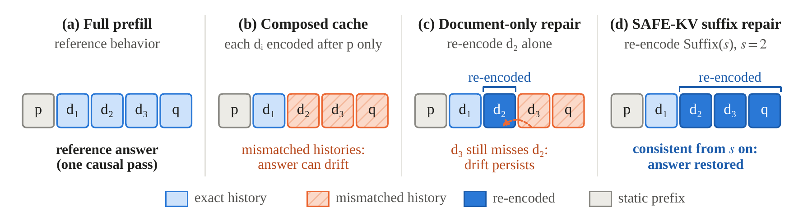
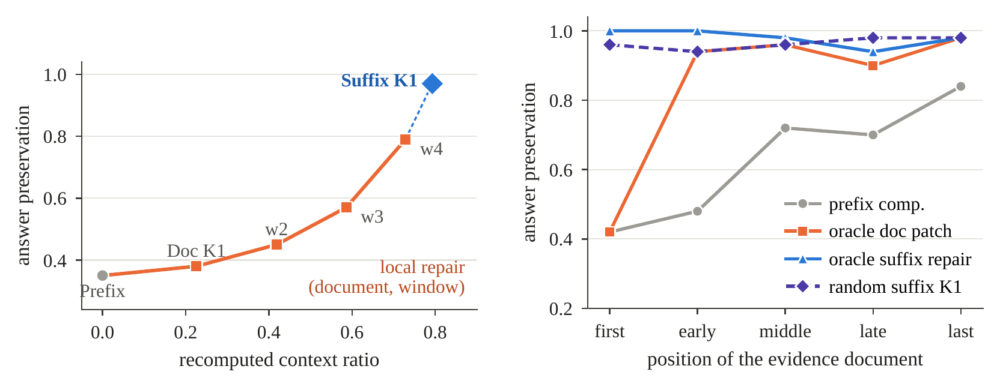

<h1 align="center">SAFE-KV</h1>

<p align="center"><b>Causal Suffix Repair for Behavior-Preserving Non-Prefix KV Cache Reuse in RAG</b></p>

<p align="center">
Xingjian Zhang · Carnegie Mellon University · <i>Findings of the Association for Computational Linguistics: IJCNLP-AACL 2026</i>, pages 3063–3098
</p>

<p align="center">
<a href="https://aclanthology.org/2026.findings-aacl.155/"></a>
<a href="paper/SAFE-KV_AACL2026_Findings.pdf"></a>
<a href="#citation"></a>
<a href="https://github.com/XingjianZhang-dev/safe-kv/releases/tag/v1.0.0"></a>
<a href="LICENSE"></a>

<a href="TEST_LOG.txt"></a>
</p>

**A cached document is not reusable text; it is a causal state.** Its keys and values were computed under a specific
prefix, position, and set of preceding documents. Non-prefix KV reuse in RAG (encode each document once, splice its
cache into later prompts) silently changes that history, and with it the model's answer. SAFE-KV makes the contract
explicit (a reused cache must reproduce the answer of full prefill on the exact prompt) and meets it by re-encoding
the **causally closed suffix** from a selected start document.

<p align="center"></p>

## Results at a glance

Qwen2.5-7B-Instruct, answer preservation relative to full prefill (normalized short-answer equivalence):

| | HotpotQA-500 | 2Wiki-500 |
|---|---:|---:|
| Prefix-conditioned composition (reuse, no repair) | 47.2% | 37.8% |
| **SAFE-KV**, risk-guided K2, donor-copy protocol | **99.8%** | **98.4%** |
| **SAFE-KV**, risk-guided K2, actual suffix forwarding | **100.0%** | **98.4%** |

- **Composition breaks answers.** Splicing prefix-conditioned document caches changes 241 (HotpotQA) and 272 (2Wiki)
  of 500 answers into wrong ones.
- **Repair must be causally closed.** Re-encoding only the selected document, or a fixed window after it, recovers far
  less: on 2Wiki-100 document-only repair reaches 38.0% and a four-document window 79.0% at 72.9% recomputation, while
  the suffix from the same start reaches 97.0% at 79.3%. When the answer document comes first, re-encoding it alone
  (42.0%) is no better than no repair at all; every later state still omits it.
- **When reuse is safe, and when it is not.** Reuse without repair is exact up to four documents and at least 99.3% at
  eight; at sixteen documents with every slice stale it falls to 80.0%, and suffix repair recovers 98–100%.
- **Selectors without construction cues.** With retrieval scores removed and documents shuffled, query and risk K2
  still preserve 91.0–96.0%.
- **Honest cost accounting.** Faithful repair re-encodes most of the context (94.8% / 92.9% at K2), so in a batch-1
  L40S study the one latency crossover fails the answer gate and SAFE-KV's operating rule serves every measured
  workload by full prefill. The lever for faster faithful reuse is a later start that is still safe.

<p align="center"></p>
<p align="center"><sub>Left (Figure 2): document-only and window repair recover answers gradually; the suffix from the same start recovers 97.0%.
Right (Figure 3): when the evidence comes first, patching the evidence document alone is no better than no repair; oracle suffix repair stays at 94–100% at every position.</sub></p>

## Quick start

### 1. SAFE-KV in one file, on any Hugging Face model

[`minimal/safekv_minimal.py`](minimal/safekv_minimal.py) implements the whole protocol (full prefill, prefix-conditioned
composition, document-only repair, causal suffix repair with actual forwarding, the query and risk selectors, and the
answer-equivalence contract) in one readable file on top of `transformers`' `DynamicCache`.

```bash
pip install -r requirements.txt
python minimal/safekv_minimal.py                         # built-in example, Qwen2.5-0.5B-Instruct (CPU is fine)
python minimal/safekv_minimal.py --model Qwen/Qwen2.5-7B-Instruct --device cuda --dtype float16 \
    --jsonl data/external_2wiki_500.jsonl --limit 100 --selector risk --k 2
```

For each example it reports the answer, whether it equals the full-prefill answer, and the fraction of document tokens
re-encoded for four caches: full prefill, prefix-conditioned composition, document-only repair, and SAFE-KV suffix
repair. As a library:

```python
from safekv_minimal import SafeKV, render_prompt, query_scores, select_start   # PYTHONPATH=minimal

skv = SafeKV(model, tokenizer)
prompt = render_prompt(tokenizer, documents, question)          # static prefix | d_1 ... d_m | query
composed = skv.compose(prompt)                                  # what a non-prefix document cache gives you
start = select_start(query_scores(question, documents), k=2)    # earliest of the top-2 documents
repaired, n_reencoded = skv.repair(prompt, composed, start)     # causal suffix repair (actual forwarding)
answer = skv.answer(prompt, repaired)                           # the query is always re-encoded
```

Its CPU tests (`python -m pytest -q minimal`) check the protocol's invariants on a tiny random model: suffix repair from
the first document reproduces full prefill, composition changes every state after the first document, document-only
repair leaves later slices stale, and the query and risk selectors choose exactly the suffixes of all 4,000 K1/K2
selections in the paper's main HotpotQA-500 and 2Wiki-500 runs. The paper's numbers come from `code/scripts/run_answer_eval.py`, which tokenizes the rendered
prompt in one pass; the one-file version tokenizes segments separately, so its outputs are close to but not identical
with the paper's.

### 2. Check every number in the paper (CPU only, no model download)

```bash
git clone https://github.com/XingjianZhang-dev/safe-kv.git && cd safe-kv
python -m venv .venv && source .venv/bin/activate
python -m pip install -U pip && python -m pip install -r requirements.txt

CUDA_VISIBLE_DEVICES='' PYTHONHASHSEED=0 PYTHONPATH=code python -B -m pytest -q -p no:cacheprovider code/tests
#   expected: 135 passed, 1 skipped (TEST_LOG.txt)
python scripts/verify_packaged_results.py            # expected files, data row counts, headline metrics: "Supplement verification passed"
shasum -a 256 -c SHA256SUMS | grep -v ': OK$' || echo "all checksums OK"

python -B scripts/camera_ready/build_tables.py       # 11 generated tables -> paper_reference/camera_ready_tables/*.tex
python -B scripts/camera_ready/tie_break_audit.py    # Table 24 (selector tie-break audit) -> paper_reference/camera_ready_tables/appendix_tie_break.tex
python -B scripts/camera_ready/make_figures.py       # plotted values of Figures 2-5 -> *.data.csv, then draws Figures 1-5
```

The generated tables and the figure CSVs are byte-identical to the shipped files, which are the ones in the paper.
`make_figures.py` writes the CSVs from the raw result files and then calls `draw_figures.py`, which draws the PDFs from
the CSVs alone. The shipped PDFs are the paper's exact files; redrawing them reproduces the same bytes with matplotlib
3.10 and Liberation Serif, and visually identical PDFs (sub-pixel layout differences only) with the pinned matplotlib
3.11.2 or another Times-like font.

### 3. Re-run the GPU experiments

[`FULL_REPRODUCTION.md`](FULL_REPRODUCTION.md) gives the environment and the exact command for every run family; each
shipped run also records its own invocation in its manifest. The configs under `configs/` point at
`Qwen/Qwen2.5-7B-Instruct`, `mistralai/Mistral-7B-Instruct-v0.3` and the small development models; the main runs used one
L40S-class GPU.

## Two protocols, two orderings

Every table in the paper states which of these it uses; they are the easiest thing to get wrong.

| | What it means | Where it appears |
|---|---|---|
| **Donor-copy protocol** | The main evaluator: KV slices of the selected suffix are *copied* from a full-prefill cache into the composed cache. Measures the repair *unit*; not a deployable path. | Tables 1, 3, 5, 25, 26 and the appendix tables that cite `results/` (main runs) |
| **Actual forwarding** | The deployable path: the selected suffix is *re-run through the model* from the retained composed prefix (`actual_recompute::*` methods of `code/scripts/run_answer_eval.py`; `SafeKV.repair` in the one-file version). | Tables 2, 6, 7, 13, 14, 18–20, 33 (`results_rebuttal/`); token-local variant in Tables 4 and 22 (`results_august/`) |
| **Gold-evidence-first construction** | The original HotpotQA-500 / 2Wiki-500 conversion: supporting paragraphs first, retrieval score 1.0 for them and at most 0.55 for distractors. The risk selector reads that score, so selector results on this construction do not show selector generalization. | Tables 1, 2(a), 3, 14–16, 25, 26 |
| **Score-neutral shuffled order** | The same examples with every retrieval score set to 0 and documents shuffled with per-example seeds 101/202/303; the label-free evidence for the selectors. | Tables 2(b), 13, 19, 23; the shuffled/BM25 localized-baseline conversions in Tables 4 and 22 are also built without gold labels |

Synthetic diagnostics (position sweep, noise sweeps, the nested staleness benchmark) assign document ids before
shuffling and give evidence documents the smallest ids; the selectors break score ties by ascending id, so query-selector
rows on those files are effectively oracle-start results (paper Sections 4.2, 6.3 and Appendix N;
`scripts/camera_ready/tie_break_audit.py`).

## Repository layout

```
minimal/              SAFE-KV in one file (safekv_minimal.py) and its CPU tests
code/                 the safekv package, experiment scripts and CPU tests that produced every run in the paper (code/README.md)
configs/              YAML configs of every run (the `risk:` block is not consumed by the selector; see below)
data/                 processed JSONL datasets: HotpotQA-500, 2Wiki-500, synthetic diagnostics, noise/position sweeps, selector splits
results/              main donor-copy runs (May 2026)
results_rebuttal/     actual-forwarding, score-neutral, staleness-grid, L40S latency, Noise64 quality-gate, oracle-diagnostic and
                      CPU selector-audit runs (July 2026); results_rebuttal/README.md is the run-status ledger;
                      results_rebuttal/data/ holds the score-neutral / nested input variants
results_august/       query-attention token-local baseline (August 2026): three runs, their datasets, and the safekv_ipm code
paper/                the camera-ready PDF
paper_reference/      generated camera-ready tables, every figure PDF with its plotted-value CSV, review-time table sources and audits
scripts/              verifier, reproduction-command emitter, camera_ready/ (table/figure generators, tie-break audit), fetch_raw_outputs.sh
assets/               README images (rendered from the paper figures)
FULL_REPRODUCTION.md  environment, commands, and the paper-result map
ARTIFACT_MANIFEST.md  what each directory contains and what was deliberately left out
FILE_MANIFEST.tsv, SHA256SUMS, RESULT_FILE_LISTING.txt, TEST_LOG.txt   integrity files
CITATION.cff, LICENSE (MIT), NOTICE, requirements.txt (pinned)
```

Directory names match the paths printed in the paper. Raw per-example dumps of four run families (232 MB) are kept out
of git and shipped as a release asset; see [Raw outputs in the release tarball](#raw-outputs-in-the-release-tarball).
Every summary file the paper uses is in git.

## Where every number comes from

Table and figure numbers are those of the camera-ready PDF. "Generated" rows are written by the commands above from the
listed files; "read from" rows are tables whose cells are the listed summaries, and
`scripts/rebuild_headline_tables.py` rebuilds the headline external/Mistral/latency audit tables from the same summaries.

| Paper item | Protocol / ordering | Command or source |
|---|---|---|
| **Table 1** main 7B external results | donor copy; gold-first | read from `results/acl_qwen25_7b_{hotpotqa,2wiki}_suffix_main_500/answer_eval_summary.json` (`scripts/rebuild_headline_tables.py`) |
| **Table 2(a)** actual forwarding, original inputs | actual forwarding; gold-first | `build_tables.py` from `results_rebuttal/actual_recompute_{hotpot,2wiki}_500/answer_eval_summary.json` and `results_rebuttal/actual_vs_copy_{hotpot,2wiki}_500_l40s_v2/donor_actual_reconciliation.json` (token exactness) |
| **Table 2(b)** score-neutral shuffled | actual forwarding; shuffled 101/202/303 | `build_tables.py` from `results_rebuttal/neutral_selector_actual_3seed_validation/neutral_selector_across_seed.csv` (per-run dirs `results_rebuttal/neutral_selector_actual_{hotpot,2wiki}_shuffle{101,202,303}_100/`) |
| **Table 3** local vs suffix repair, 2Wiki-100 | donor copy; gold-first | read from `results/acl_qwen25_7b_2wiki_downstream_window_100/answer_eval_summary.json` |
| **Table 4** operational token-local baseline | token-local actual recompute; natural / shuffled / BM25 (no gold labels) | `build_tables.py` from `results_august/run_registry/qwen25_query_attention_hotpotqa_{natural,shuffle,bm25}_test_n100_v1/query_attention_local_summary.csv` |
| **Table 5** position sensitivity | donor copy; synthetic (Noise16, 19 documents) | read from `results/acl_qwen25_7b_position_noise16_50x5_suffix/position_summary.csv` and `answer_eval_summary.json` |
| **Table 6** staleness x document count (compact) | actual forwarding; nested synthetic, scores zero, layout seed 101 | `build_tables.py` from `results_rebuttal/staleness_doccount_full_50_v3/staleness_doccount_summary.csv` |
| **Table 7** time to first logit, five L40S workloads | actual forwarding incl. selector planning; orderings as in the rows | `build_tables.py` from `results_rebuttal/latency_{hotpot_original,2wiki_original,2wiki_neutral_shuffle101,n16_neutral_layout101,noise64}_50_v1/latency_trace_summary.json` and `latency_paired_bootstrap_summary.csv`; Noise64 gate from `results_rebuttal/quality_noise64_actual_riskk1_50_v1/` |
| **Table 8** full early composition ablation (Qwen2.5-0.5B) | development; synthetic | read from `results/paper_tables/results_paper/table1_composition_ablation.csv` |
| **Table 9** full early repair-granularity diagnostic (Qwen2.5-0.5B) | development; synthetic | read from `results/paper_tables/results_paper/table2_repair_granularity.csv` |
| **Table 10** full synthetic answer-level table (small models) | development; synthetic | read from `results/paper_tables/results_paper/table3_answer_level_synthetic.csv` (`results/metrics/results_*_answer/`) |
| **Table 11** external and cross-model summary | donor copy; gold-first / Mistral noisy | read from the Table 1 summaries, `results/paper_tables/results_paper/table5_external_full_prefill_correct_subset.csv`, and `results/acl_mistral7b_noisy_suffix_250_balanced/answer_eval_summary.json` |
| **Table 12** full Qwen2.5-7B external answer-level results | donor copy; gold-first | read from `results/acl_qwen25_7b_{hotpotqa,2wiki}_suffix_main_500/answer_eval_summary.json` (all methods) |
| **Table 13** per-seed values behind Table 2(b) | actual forwarding; shuffled | `build_tables.py` from `results_rebuttal/neutral_selector_actual_3seed_validation/neutral_selector_by_seed.csv` |
| **Table 14** same-run donor-copy vs actual-forwarding reconciliation | both; gold-first | `build_tables.py` from `results_rebuttal/actual_vs_copy_{hotpot,2wiki}_500_l40s_v2/donor_actual_reconciliation.json` |
| **Table 15** robustness and calibration checks | donor copy; gold-first | read from `results/acl_qwen25_7b_{hotpotqa,2wiki}_suffix_main_500/bootstrap_ci/bootstrap_pairwise_delta_ci.csv`, the held-out summaries of Table 16, and the Table 17 latency summaries |
| **Table 16** held-out calibration | donor copy; gold-first | read from `results/acl_qwen25_7b_{hotpotqa,2wiki}_suffix_main_500/heldout_method_calibration_safekv_only/heldout_method_calibration_summary.csv` |
| **Table 17** early prototype latency | donor copy, no selector planning | read from `results/acl_qwen25_7b_2wiki_latency_suffix_50_with_hybrid/latency_summary.json` and `results/acl_qwen25_7b_noise64_latency_suffix_20_with_hybrid/latency_summary.json` |
| **Table 18** all timed methods, five workloads | actual forwarding incl. planning | `build_tables.py` from the five `results_rebuttal/latency_*_50_v1/latency_trace_summary.json` and `latency_paired_bootstrap_summary.csv` |
| **Table 19** selector CPU cost | CPU, inside the timed path / separate audit | `build_tables.py` from `selector_latency.csv` in the five latency runs and `results_rebuttal/cpu_selector_audit_l40s_host/latency.csv` |
| **Table 20** Noise64 quality gate | both | `build_tables.py` from `results_rebuttal/quality_noise64_actual_riskk1_50_v1/answer_eval_summary.json`, `donor_actual_reconciliation.json`, `bootstrap/bootstrap_{method,pairwise_delta}_ci.csv` |
| **Table 21** noise-sweep and closure diagnostics | donor copy; synthetic | read from `results/acl_qwen25_7b_noise_sweep_{0,8,16}_250/`, `results/acl_qwen25_7b_noise16_{k_sweep,closure}_250/answer_eval_summary.json` |
| **Table 22** token-local baseline, full budget curves | token-local actual recompute; natural / shuffled / BM25 | `build_tables.py` from the three `query_attention_local_summary.csv` of Table 4 |
| **Table 23** oracle KV-drift token-local diagnostic | oracle donor copy; shuffled 101 | `build_tables.py` from `results_rebuttal/oracle_kv_drift_2wiki_neutral_shuffle101_100_v3/oracle_kv_drift_summary.json` and `oracle_paired_bootstrap_summary.json` |
| **Table 24** tie-break audit | CPU selectors on the shipped inputs | `tie_break_audit.py` on `data/`, `results_rebuttal/data/` with `code/safekv/doc_selector.py` |
| **Table 25** selector and budget operating points | donor copy; gold-first / Mistral noisy | read from `results/acl_qwen25_7b_2wiki_suffix_main_500/answer_eval_summary.json` and `results/acl_mistral7b_noisy_suffix_250_balanced/answer_eval_summary.json` |
| **Table 26** selector evidence-recall diagnostics | selector only; gold-first | read from `results/selector_artifacts/selector_quality_{hotpotqa,2wiki}_500.csv` |
| **Table 27** design ledger | donor copy; mixed | narrative of the runs above (`results/acl_qwen25_7b_noise16_*`, `results/acl_qwen25_7b_2wiki_adaptive_interval_200`, learned selector in `results/selector_artifacts/`) |
| **Table 28** result inventory | — | `RESULT_FILE_LISTING.txt` (counts in the header) |
| **Tables 29–31** compact development tables (Qwen2.5-0.5B/1.5B) | development; synthetic | read from the Table 8–10 CSVs and `results/metrics/results_{qwen05,qwen15}_100{,_noisy}_answer/` |
| **Table 32** related-work positioning | — | no data |
| **Table 33** full staleness grid (26,250 rows) | actual forwarding; nested synthetic | `build_tables.py` from `results_rebuttal/staleness_doccount_full_50_v3/staleness_doccount_summary.csv` (clustered intervals; `validation_report.json` = PASS) |
| **Figure 1** causal-state schematic (Section 1) | — | `draw_figures.py` (conceptual; no data) |
| **Figure 2** local vs suffix repair (Section 6.2) | donor copy; gold-first | `make_figures.py` from `results/acl_qwen25_7b_2wiki_downstream_window_100/answer_eval_summary.json` → `paper_reference/final_figures/figure_local_vs_suffix.data.csv` |
| **Figure 3** position sweep (Section 6.3) | donor copy; synthetic | `make_figures.py` from `results/acl_qwen25_7b_position_noise16_50x5_suffix/position_summary.csv` → `figure_position_sweep.data.csv` |
| **Figure 4** robustness checks (Appendix H) | donor copy | `make_figures.py` from `results/acl_qwen25_7b_{hotpotqa,2wiki}_suffix_main_500/answer_eval_metrics.csv` (full-prefill-correct subsets, recomputed per example) and the Mistral summary → `figure5_external_sanity.data.csv` |
| **Figure 5** quality–budget points and L40S latency (Appendix K) | donor copy (left) / actual forwarding (right) | `make_figures.py` from the Table 1 2Wiki summary and the five `latency_trace_summary.json` → `figure4_budget_gate_pareto.data.csv` |

Every processed input the runs used is in `data/` (main runs), `results_rebuttal/data/` (score-neutral and nested
variants, rebuilt byte-for-byte by `code/scripts/build_rebuttal_variants.py`), and `results_august/datasets/`
(localized-baseline conversions with their build manifest).

## Raw outputs in the release tarball

To keep the repository around 190 MB with no file above 25 MB, the raw per-example dumps of four run families
(232 MB) are not in git. They are the release asset `safe-kv-raw-outputs-v1.0.0.tar.gz` of release tag `v1.0.0`:

| File(s) | Size | What it is | Summary kept in git |
|---|---|---|---|
| `results_rebuttal/staleness_doccount_full_50_v3/staleness_doccount_outputs.jsonl` | 35 MB | 26,250 per-example rows of the staleness grid | `staleness_doccount_summary.{csv,json}`, `staleness_paired_bootstrap_summary.{csv,json}`, `validation_report.json` |
| `results_august/run_registry/*/query_attention_local_outputs.jsonl` (3 runs) | 59 MB | per-example outputs of the token-local baseline | `query_attention_local_summary.{csv,json}`, `run_manifest.json`, logs |
| `results/paper_tables/results_paper/heldout_gate_calibration_outputs.jsonl` | 98 MB | per-example rows of the small-model budget-gate calibration | `heldout_gate_calibration_{summary.json,metrics.csv,report.md}` |
| `results/metrics/results_budget_gate/*/budget_gate_metrics.csv` (6 files) | 40 MB | per-example metrics of the small-model budget-gate development runs | `results/summaries/results_budget_gate/*/` and `budget_gate_pareto.csv` next to each |

`bash scripts/fetch_raw_outputs.sh` downloads the asset, verifies its SHA-256 and every extracted file, and restores the
files in place; each affected directory carries a `RAW_OUTPUTS_IN_RELEASE.txt` with the names, sizes and hashes. None
of the paper's tables or figures need these files.

## Implementation note: the risk selector

The `risk:` block in `configs/*.yaml` (`similarity_backend: tfidf` and six weights) is not read by the selector.
`code/safekv/doc_selector.py::risk_guided_doc_scores` hard-codes the executed formula
`0.25*retrieval + 0.30*query + 0.20*entity + 0.15*conflict + 0.10*shared_entity` with lexical (not TF-IDF) query
recall; `query_similarity_doc_scores` is plain question-term recall. Every reported run used the hard-coded formula;
ties are broken by ascending document id (paper Appendix N).

The configs and manifests under `results_august/code/configs/` and in the run manifests record the paths of the
original GPU hosts (`/workspace/...`, `/root/autodl-tmp/...`); replace them with your own model and data locations
when re-running (`FULL_REPRODUCTION.md`, Sections 6–7).

## Versions

The paper cites the version-locked tag [`v1.0.0`](https://github.com/XingjianZhang-dev/safe-kv/tree/v1.0.0). The `main`
branch adds the one-file implementation (`minimal/`), the camera-ready figure style (`draw_figures.py`), the paper PDF,
`CITATION.cff` and this README, and lets `scripts/verify_packaged_results.py` run inside a git clone; every data
file, result file, and number is unchanged (`python scripts/verify_packaged_results.py`, `SHA256SUMS`,
`ARTIFACT_MANIFEST.md`).

## Licensing

The code, configs, and derived result files are released under the MIT License (`LICENSE`). Model weights are not
redistributed; the public benchmark data are not redistributed beyond the processed examples used in the experiments,
which stay under the original datasets' terms (HotpotQA: CC BY-SA 4.0); third-party dependencies are under their own
licenses. See `NOTICE`.

## Citation

If you use SAFE-KV, its evaluation protocol, or its per-example outputs, please cite:

```bibtex
@inproceedings{zhang-2026-safe,
  title     = {{SAFE}-{KV}: Causal Suffix Repair for Behavior-Preserving Non-Prefix {KV} Cache Reuse in {RAG}},
  author    = {Zhang, Xingjian},
  booktitle = {Findings of the Association for Computational Linguistics: IJCNLP-AACL 2026},
  month     = nov,
  year      = {2026},
  address   = {Hengqin, China},
  publisher = {Association for Computational Linguistics},
  url       = {https://aclanthology.org/2026.findings-aacl.155/},
  pages     = {3063--3098}
}
```

Questions and issues are welcome on the [issue tracker](https://github.com/XingjianZhang-dev/safe-kv/issues) or at
xingjiaz@andrew.cmu.edu.
